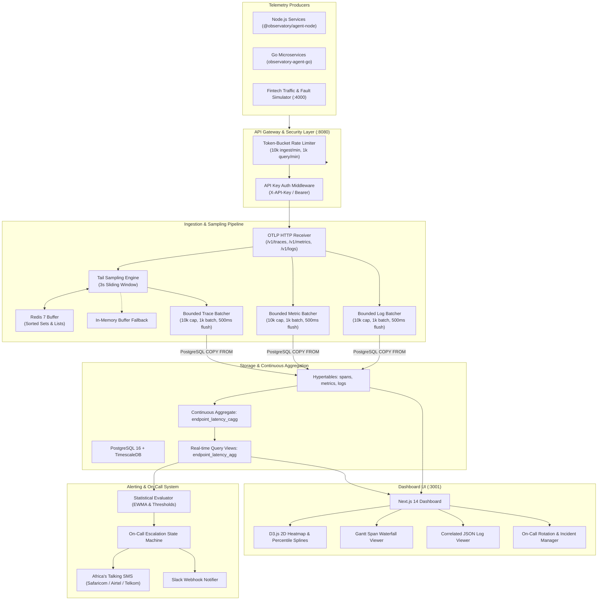
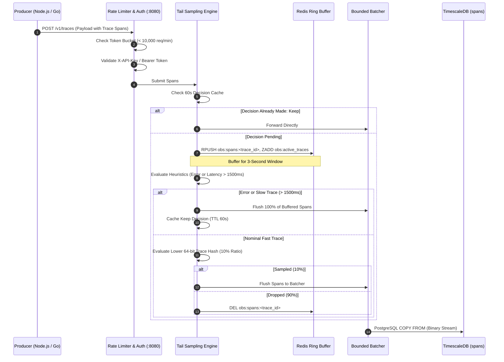
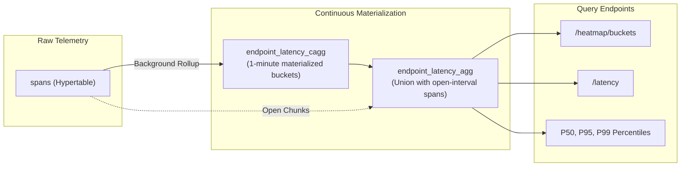
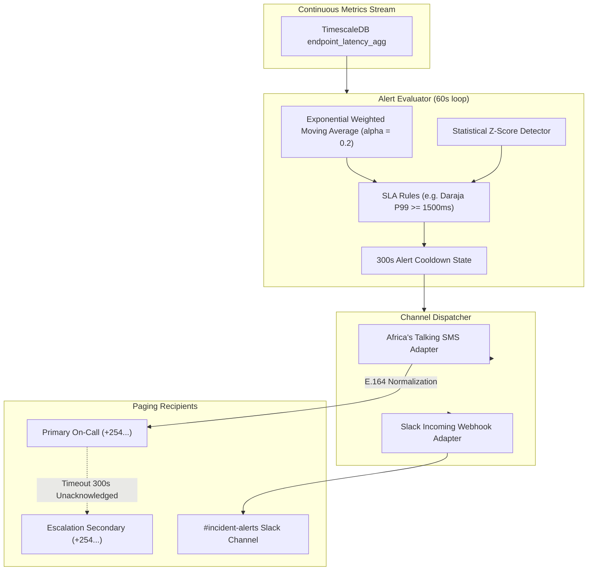

# Observatory APM Architecture

Observatory APM is a self-hosted unified observability platform engineered for high-throughput Kenyan fintech, digital banking, and telecommunications infrastructures. It captures metrics, distributed traces, and structured logs with automated Safaricom Daraja M-Pesa SLA compliance monitoring, USSD session state tracking, tail-based anomaly sampling, and multi-channel on-call alerting via Africa's Talking SMS and Slack.

---

## 1. High-Level System Architecture



---

## 2. Ingestion & Tail Sampling Lifecycle

The telemetry ingestion pipeline implements a hybrid sampling strategy:
1. **Agent Head Sampling**: Non-critical client traces are pre-sampled at 10% using 64-bit deterministic hash evaluation on the trace ID.
2. **Ingestion Tail Sampling**: All traces arriving at the API are buffered for 3 seconds in Redis (or an in-memory ring buffer).
3. **Anomaly Retention Heuristics**:
   - **100% Errors**: Traces with HTTP 5xx or `STATUS_CODE_ERROR` are retained.
   - **100% Slow Root Spans**: Traces exceeding the Daraja M-Pesa 1500ms SLA threshold are retained.
   - **10% Baseline**: Fast, nominal traces are sampled uniformly at 10%.
   - **Decision Cache**: Retained trace IDs are cached for 60 seconds so late-arriving spans bypass buffering.



---

## 3. Storage & Continuous Aggregation Engine

To guarantee sub-5ms query performance for D3 interactive heatmaps and latency distribution charts, Observatory APM avoids full hypertable scans over millions of spans by leveraging TimescaleDB Continuous Aggregates:



Continuous aggregate highlights:
- Materializes 1-minute bucket summaries: span count, error count, min duration, max duration, and percentile estimations using `percentile_cont(0.50)`, `percentile_cont(0.95)`, and `percentile_cont(0.99)`.
- Continuous aggregate compression policy compresses chunks older than 2 hours.
- Raw spans hypertable applies 7-day chunking with TimescaleDB segment-by-service compression.

---

## 4. Alerting & On-Call Escalation Architecture



Key alerting features:
- **Kenyan Phone Number Formatting**: Normalizes `07...`, `01...`, `254...`, `+254...` into valid E.164 format for Safaricom, Airtel Kenya, and Telkom Kenya.
- **Statistical Filtering**: EWMA smoothing prevents noisy false alarms during brief, transient network blips.
- **Escalation Timers**: Incidents left unacknowledged escalate after 300 seconds to secondary on-call engineers.

---

## 5. Monorepo Structure

```
observatory-apm/
├── api/                     # Go 1.22 Ingestion & Query REST API
│   ├── alerts/              # Statistical EWMA evaluator, SMS & Slack dispatchers
│   ├── config/              # Environment configuration loader
│   ├── handlers/            # HTTP handlers for services, latency, heatmap, traces, logs
│   ├── ingest/              # OTLP receivers and bounded worker batchers
│   ├── middleware/          # API Key auth & token-bucket rate limiter
│   ├── oncall/              # In-memory incident and escalation store
│   ├── sampling/            # Tail-based 3s sliding-window Redis ring buffer engine
│   └── main.go              # Service entry point & Chi HTTP router
├── db/                      # Database schemas & migrations
│   ├── schema.sql           # TimescaleDB hypertables, indexes, and continuous aggregates
│   └── seed.sql             # Realistic Kenyan fintech & USSD seed fixtures
├── demo/                    # Traffic & Fault Simulator (:4000)
│   ├── src/mpesa.ts         # Safaricom Daraja STK Push & B2C payment scenarios
│   ├── src/ussd.ts          # Telco USSD banking session state machines
│   └── src/index.ts         # Express server with simulated fault injections
├── docs/                    # Architecture and Decision Records
│   ├── adr/                 # Architecture Decision Records (0001, 0002, 0003)
│   └── architecture.md      # Detailed platform design specifications
├── e2e/                     # End-to-End Playwright test suite
│   ├── tests/drilldown.spec.ts  # Heatmap, waterfall, logs, on-call & simulator tests
│   └── playwright.config.ts # Playwright browser runner configuration
├── packages/                # Telemetry SDK Agents
│   ├── agent-node/          # Node.js / Express / Fastify instrumentation agent
│   └── agent-go/            # Go HTTP middleware & span tracking client
└── web/                     # Next.js 14 APM Dashboard (:3001)
    ├── components/          # D3 Heatmap, Gantt Waterfall, Log Viewer, Simulator
    ├── pages/               # Dashboard, Alerts & Rules, On-Call rotations
    └── utils/               # Authenticated API client with offline fallback support
```

